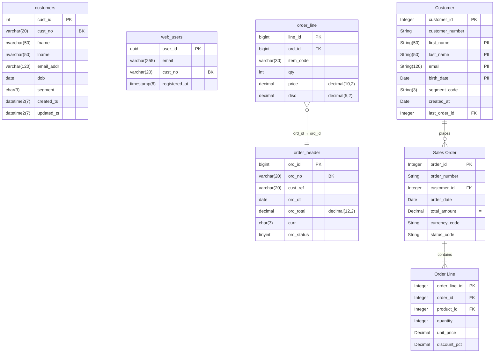
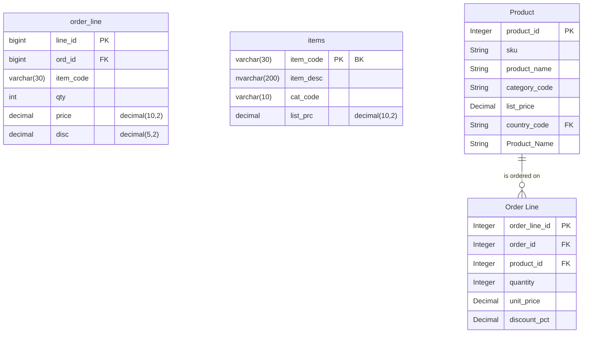
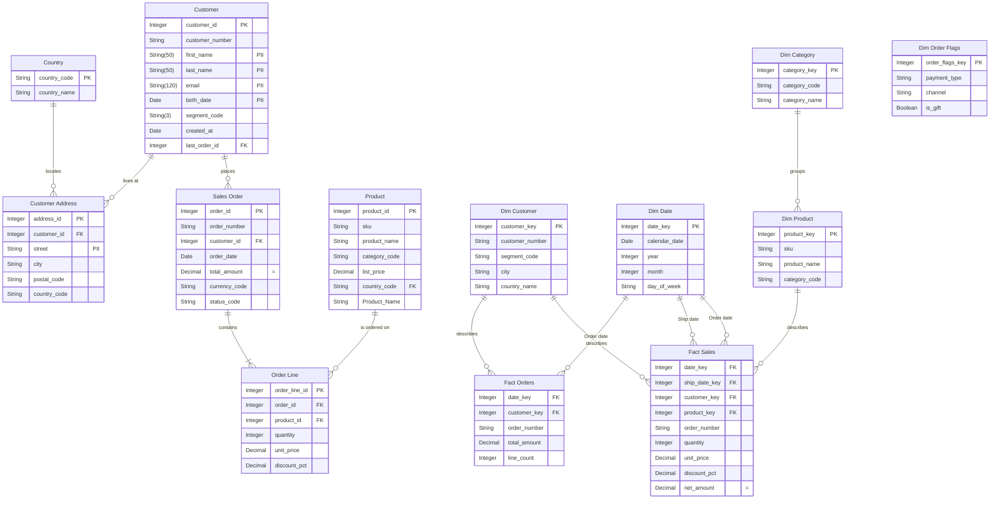

# Retail Co – stage 1 documentation

Diagrams are Mermaid code blocks: open the file in any Markdown tool that renders Mermaid (VS Code, Obsidian, GitLab, mermaid.live).

## Contents

- [Introduction](#introduction)
- [Conventions and notation](#conventions-and-notation)
- [Model overview](#model-overview)
- [Model readiness](#model-readiness)
- [Diagrams](#diagrams)
- [Data dictionary](#data-dictionary)
- [Source-to-target mapping](#source-to-target-mapping)
- [Requirements and coverage](#requirements-and-coverage)
- [Traceability](#traceability)
- [Data quality rules](#data-quality-rules)
- [Source tables](#source-tables)
- [Classification register](#classification-register)

## Introduction

Scope of this stage: …

Assumptions: …

Open points: …

## Conventions and notation

### Relationship notation

| Mark | Meaning |
| --- | --- |
| `\|\|` / `\|\|` | Exactly one |
| `\|o` / `o\|` | Zero or one |
| `}\|` / `\|{` | One or more |
| `}o` / `o{` | Zero or more |

### Mapping statuses

| Status | Meaning |
| --- | --- |
| Draft | Proposed; not reviewed yet. |
| In review | Waiting for approval. |
| Approved | Agreed; counts towards requirement coverage. |

### Marks in diagrams and tables

| Mark | Meaning |
| --- | --- |
| **PK** | Primary key |
| **FK** | Foreign key |
| BK | Business key in the source |
| PII | Personal data |
| **`=`** | Calculated from other attributes of the same entity |
| ƒ | Transformation rule on the mapping |
| ! | The source type does not fit the attribute |
| ● ○ | Row fed (filled) or not yet (ring) |

### Entity stereotypes

| Stereotype | Used | Definition |
| --- | --- | --- |
| **Object** | 4 | A business thing with its own identity and life cycle: customer, product, order. |
| **Link** | 1 | Connects objects and takes its identity from them, e.g. an order line. |
| **Dictionary** | 1 | A list of codes and their meanings (reference data). |

### Classifications used

| Classifications | Code | Applies to | Used | Definition |
| --- | --- | --- | --- | --- |
| Business key | `BK` | Column | 4 | The column identifies the business object in the source; it survives system changes. |
| Personal data | `PII` | Column | 6 | The column holds personal data in the sense of the GDPR. |

### Physical types in the sources and their logical types

| Physical type | Logical type |
| --- | --- |
| `bigint` | integer |
| `char(2), char(3)` | string |
| `date` | date |
| `datetime2(7)` | datetime |
| `decimal(10,2), decimal(12,2), decimal(5,2)` | decimal |
| `int` | integer |
| `nvarchar(100), nvarchar(200), nvarchar(50), nvarchar(60)` | string |
| `timestamp(6)` | datetime |
| `tinyint` | integer |
| `uuid` | string |
| `varchar(10), varchar(120), varchar(20), varchar(255), varchar(30)` | string |

## Model overview

Enterprise data warehouse for Retail Co: customers, orders and products from CRM, web shop and ERP.

| Model contents | Count |
| --- | --- |
| Entities | 13 |
| Source tables | 6 |
| Mappings | 14 (9 approved) |
| Requirements | 6 |

- **Customer**: Customer, Customer Address, Dim Customer
- **Sales**: Dim Order Flags, Fact Orders, Fact Sales, Order Line, Sales Order
- **Product**: Dim Category, Dim Product, Product
- **Reference data**: Country, Dim Date

## Model readiness

Checks of the model state this document describes. The items listed were open when it was generated.

| Check | Result |
| --- | --- |
| Entities without a definition | **4** |
| Attributes without a definition | **60** |
| Definitions that repeat the name or have fewer than four words | ✓ |
| Attributes with no mapping or feed | **39** |
| Mappings with a type problem | **2** |
| Mappings not approved yet | **5** |
| Requirements not fully covered | **3** |
| Keys copied the wrong way (High) | **1** |
| Duplicate attribute names | **1** |
| Calculated and mapped | **1** |
| Keys copied without a relationship | **1** |
| Relationships without a copied key | **1** |
| Approved feeds over logical attributes not yet covered | **10** |

Model checks: InfoMapper's validator (D-75), as the project home shows it.

### Entities without a definition (4)

- Country
- Customer Address
- Dim Product
- Product

### Attributes without a definition (60)

- Country.country_code
- Country.country_name
- Customer.customer_number
- Customer.first_name
- Customer.last_name
- Customer.email
- Customer.created_at
- Customer.last_order_id
- Customer Address.address_id
- Customer Address.customer_id
- … and 50 more

### Attributes with no mapping or feed (39)

- Country.country_code
- Country.country_name
- Customer.segment_code
- Customer.last_order_id
- Customer Address.address_id
- Customer Address.customer_id
- Customer Address.street
- Customer Address.city
- Customer Address.postal_code
- Customer Address.country_code
- … and 29 more

### Mappings with a type problem (2)

- web_users.email → Customer.email
- order_line.item_code → Order Line.product_id

### Mappings not approved yet (5)

- web_users.email → Customer.email (Draft)
- customers.dob → Customer.birth_date (In review)
- customers.created_ts → Customer.created_at (In review)
- order_line.item_code → Order Line.product_id (Draft)
- order_header.ord_status → Sales Order.status_code (Draft)

### Requirements not fully covered (3)

- REQ-210 Net sales by customer segment and month (0/3)
- REQ-104 Order total equals the sum of its lines (1/4)
- REQ-105 Personal data is encrypted at rest (3/4)

### Keys copied the wrong way · High (1)

- Customer.last_order_id · copy of Sales Order.order_id, but Customer is the one side of “places”

### Duplicate attribute names (1)

- Product: product_name, Product_Name · 2 attributes, one name

### Calculated and mapped (1)

- Sales Order.total_amount · calculated from 0, also 1 mapping

### Keys copied without a relationship (1)

- Product.country_code · copy of Country.country_code; Product and Country are not related

### Relationships without a copied key (1)

- Country – Customer Address (locates) · Customer Address has no copy of country_code

### Approved feeds over logical attributes not yet covered (10)

- Customer.segment_code → Dim Customer.segment_code · segment_code is not mapped
- Product.sku → Dim Product.sku · sku is not mapped
- Product.product_name → Dim Product.product_name · product_name is not mapped
- Product.category_code → Dim Product.category_code · category_code is not mapped
- Sales Order.customer_id → Fact Orders.customer_key · customer_id is not mapped
- Sales Order.customer_id → Fact Sales.customer_key · customer_id is not mapped
- Order Line.product_id → Fact Sales.product_key · product_id has no approved source mapping
- Order Line.quantity → Fact Sales.quantity · quantity is not mapped
- Order Line.unit_price → Fact Sales.unit_price · unit_price is not mapped
- Order Line.discount_pct → Fact Sales.discount_pct · discount_pct is not mapped

## Diagrams

### Customer & orders

**Mappings**

- `customers.cust_id` → `Customer.customer_id`
- `customers.cust_no` → `Customer.customer_number`
- `customers.fname` → `Customer.first_name`
- `customers.lname` → `Customer.last_name`
- `customers.email_addr` → `Customer.email`
- `customers.dob` → `Customer.birth_date` (In review)
- `customers.created_ts` → `Customer.created_at` (In review) · ƒ: CAST(created_ts AS date)
- `web_users.email` → `Customer.email` (Draft) · type problem
- `order_header.ord_id` → `Sales Order.order_id`
- `order_header.ord_no` → `Sales Order.order_number`
- `order_header.ord_dt` → `Sales Order.order_date`
- `order_header.ord_total` → `Sales Order.total_amount`
- `order_header.ord_status` → `Sales Order.status_code` (Draft) · ƒ: Decode with the ERP status dictionary (ref.order_status)
- `order_line.item_code` → `Order Line.product_id` (Draft) · type problem

**Requirements**

- REQ-104 Order total equals the sum of its lines → Sales Order.total_amount, Order Line.quantity, Order Line.unit_price, Order Line.discount_pct

*Figure 1. Customer & orders*

### Order lines & products

**Mappings**

- `order_line.item_code` → `Order Line.product_id` (Draft) · type problem

*Figure 2. Order lines & products*

### Sales star

**Roles**

- **Dim Customer**: Dimension
- **Dim Date**: Dimension
- **Dim Product**: Dimension · Snapshot
- **Fact Sales**: Fact
- **Fact Orders**: Fact · Aggregate
- **Dim Category**: Dimension · Outrigger
- **Dim Order Flags**: Dimension · Junk

**Dimensional mappings**

- `Sales Order.order_date` → `Fact Sales.date_key` · ƒ
- `Sales Order.customer_id` → `Fact Sales.customer_key` · ƒ
- `Order Line.product_id` → `Fact Sales.product_key` · ƒ
- `Sales Order.order_number` → `Fact Sales.order_number`
- `Order Line.quantity` → `Fact Sales.quantity`
- `Order Line.unit_price` → `Fact Sales.unit_price`
- `Order Line.discount_pct` → `Fact Sales.discount_pct`
- `Customer.customer_number` → `Dim Customer.customer_number`
- `Customer.segment_code` → `Dim Customer.segment_code`
- `Customer Address.city` → `Dim Customer.city` (Draft)
- `Country.country_name` → `Dim Customer.country_name` (Draft) · L
- `Product.sku` → `Dim Product.sku`
- `Product.product_name` → `Dim Product.product_name`
- `Product.category_code` → `Dim Product.category_code`
- `Sales Order.order_date` → `Fact Orders.date_key` · ƒ
- `Sales Order.customer_id` → `Fact Orders.customer_key` · ƒ
- `Sales Order.order_number` → `Fact Orders.order_number`
- `Sales Order.total_amount` → `Fact Orders.total_amount`
- `Order Line.order_line_id` → `Fact Orders.line_count` (Draft) · ƒ

*Figure 3. Sales star*

## Data dictionary

### Customer

#### Customer

Object · 7 of 9 attributes mapped

A person or organisation that buys from us.

| Attribute | Type | Keys | Personal data | Mapped from | Definition |
| --- | --- | --- | --- | --- | --- |
| `customer_id` | `integer` | `PK` | | `customers.cust_id` | The customer's number in the CRM; one per person or organisation. |
| `customer_number` | `string` | | | `customers.cust_no` | |
| `first_name` | `string(50)` | | **PII** | `customers.fname` | |
| `last_name` | `string(50)` | | **PII** | `customers.lname` | |
| `email` | `string(120)` | | **PII** | `customers.email_addr`, `web_users.email` (Draft) | |
| `birth_date` | `date` | | **PII** | `customers.dob` (In review) | Date of birth as the customer gave it. Personal data: shown only to those who need it. |
| `segment_code` | `string(3)` | | | Not mapped | The marketing segment, a three-letter code from the CRM's segment list. |
| `created_at` | `date` | | | `customers.created_ts` (In review) | |
| `last_order_id` | `integer` | `FK` | | Not mapped | |

##### Relationships

| Related entity | Relationship | Cardinality (this : related) |
| --- | --- | --- |
| **Sales Order** | places | `1 : 0..*` |
| **Customer Address** | lives at | `1 : 0..*` |

#### Customer Address

Object · 0 of 6 attributes mapped

| Attribute | Type | Keys | Personal data | Mapped from | Definition |
| --- | --- | --- | --- | --- | --- |
| `address_id` | `integer` | `PK` | | Not mapped | |
| `customer_id` | `integer` | `FK` | | Not mapped | |
| `street` | `string` | | **PII** | Not mapped | |
| `city` | `string` | | | Not mapped | |
| `postal_code` | `string` | | | Not mapped | The postal code as written on the address, without spaces removed. |
| `country_code` | `string` | | | Not mapped | |

##### Relationships

| Related entity | Relationship | Cardinality (this : related) |
| --- | --- | --- |
| **Customer** | lives at | `0..* : 1` |
| **Country** | locates | `0..* : 1` |

#### Dim Customer

Dimension · 4 of 5 attributes mapped

The customer as reports see it, with its history.

| Attribute | Type | Keys | Mapped from |
| --- | --- | --- | --- |
| `customer_key` | `integer` | `PK` | Not mapped |
| `customer_number` | `string` | | `Customer.customer_number` |
| `segment_code` | `string` | | `Customer.segment_code` |
| `city` | `string` | | `Customer Address.city` (Draft) |
| `country_name` | `string` | | `Country.country_name` (Draft) |

##### Relationships

| Related entity | Relationship | Cardinality (this : related) |
| --- | --- | --- |
| **Fact Sales** | describes | `1 : 0..*` |
| **Fact Orders** | describes | `1 : 0..*` |

### Sales

#### Dim Order Flags

Junk dimension · 0 of 4 attributes mapped

Payment type, channel and gift flag of an order line.

| Attribute | Type | Keys | Mapped from |
| --- | --- | --- | --- |
| `order_flags_key` | `integer` | `PK` | Not mapped |
| `payment_type` | `string` | | Not mapped |
| `channel` | `string` | | Not mapped |
| `is_gift` | `boolean` | | Not mapped |

#### Fact Orders

Transaction fact, aggregate of Fact Sales · 5 of 5 attributes mapped

Orders as a whole, one row per order.

| Attribute | Type | Keys | Mapped from |
| --- | --- | --- | --- |
| `date_key` | `integer` | `FK` | `Sales Order.order_date` |
| `customer_key` | `integer` | `FK` | `Sales Order.customer_id` |
| `order_number` | `string` | | `Sales Order.order_number` |
| `total_amount` | `decimal` | | `Sales Order.total_amount` |
| `line_count` | `integer` | | `Order Line.order_line_id` (Draft) |

##### Relationships

| Related entity | Relationship | Cardinality (this : related) |
| --- | --- | --- |
| **Dim Customer** | describes | `0..* : 1` |
| **Dim Date** | dates · Order date | `0..* : 1` |

#### Fact Sales

Transaction fact · 8 of 9 attributes mapped

Sales of products, one row per order line.

| Attribute | Type | Keys | Mapped from |
| --- | --- | --- | --- |
| `date_key` | `integer` | `FK` | `Sales Order.order_date` |
| `ship_date_key` | `integer` | `FK` | Not mapped |
| `customer_key` | `integer` | `FK` | `Sales Order.customer_id` |
| `product_key` | `integer` | `FK` | `Order Line.product_id` |
| `order_number` | `string` | | `Sales Order.order_number` |
| `quantity` | `integer` | | `Order Line.quantity` |
| `unit_price` | `decimal` | | `Order Line.unit_price` |
| `discount_pct` | `decimal` | | `Order Line.discount_pct` |
| `net_amount` | `decimal` | | = quantity, unit_price, discount_pct |

##### Relationships

| Related entity | Relationship | Cardinality (this : related) |
| --- | --- | --- |
| **Dim Customer** | describes | `0..* : 1` |
| **Dim Product** | describes | `0..* : 1` |
| **Dim Date** | dates · Order date | `0..* : 1` |
| **Dim Date** | dates · Ship date | `0..* : 1` |

#### Order Line

Link · 1 of 6 attributes mapped

One product on one order.

| Attribute | Type | Keys | Mapped from | Definition |
| --- | --- | --- | --- | --- |
| `order_line_id` | `integer` | `PK` | Not mapped | |
| `order_id` | `integer` | `FK` | Not mapped | |
| `product_id` | `integer` | `FK` | `order_line.item_code` (Draft) | |
| `quantity` | `integer` | | Not mapped | How many units of the product the customer ordered on this line. |
| `unit_price` | `decimal` | | Not mapped | |
| `discount_pct` | `decimal` | | Not mapped | The discount on this line in per cent; zero when there is none. |

##### Relationships

| Related entity | Relationship | Cardinality (this : related) |
| --- | --- | --- |
| **Sales Order** | contains | `1..* : 1` |
| **Product** | is ordered on | `0..* : 1` |

#### Sales Order

Object · 5 of 7 attributes mapped

A confirmed order placed by a customer.

| Attribute | Type | Keys | Mapped from | Definition |
| --- | --- | --- | --- | --- |
| `order_id` | `integer` | `PK` | `order_header.ord_id` | |
| `order_number` | `string` | | `order_header.ord_no` | The number printed on the order confirmation; unique per order. |
| `customer_id` | `integer` | `FK` | Not mapped | |
| `order_date` | `date` | | `order_header.ord_dt` | The day the customer placed the order, in the shop's time zone. |
| `total_amount` | `decimal` | | `order_header.ord_total` | The order's value after discounts, in the order's currency. |
| `currency_code` | `string` | | Not mapped | |
| `status_code` | `string` | | `order_header.ord_status` (Draft) | Where the order stands: open, shipped, delivered or cancelled. |

##### Relationships

| Related entity | Relationship | Cardinality (this : related) |
| --- | --- | --- |
| **Customer** | places | `0..* : 1` |
| **Order Line** | contains | `1 : 1..*` |

### Product

#### Dim Category

Dimension, outrigger of Dim Product · 0 of 3 attributes mapped

Product categories, shared by products.

| Attribute | Type | Keys | Mapped from |
| --- | --- | --- | --- |
| `category_key` | `integer` | `PK` | Not mapped |
| `category_code` | `string` | | Not mapped |
| `category_name` | `string` | | Not mapped |

##### Relationships

| Related entity | Relationship | Cardinality (this : related) |
| --- | --- | --- |
| **Dim Product** | groups | `1 : 0..*` |

#### Dim Product

Dimension, snapshot (Month-end) · 3 of 4 attributes mapped

| Attribute | Type | Keys | Mapped from |
| --- | --- | --- | --- |
| `product_key` | `integer` | `PK` | Not mapped |
| `sku` | `string` | | `Product.sku` |
| `product_name` | `string` | | `Product.product_name` |
| `category_code` | `string` | | `Product.category_code` |

##### Relationships

| Related entity | Relationship | Cardinality (this : related) |
| --- | --- | --- |
| **Fact Sales** | describes | `1 : 0..*` |
| **Dim Category** | groups | `0..* : 1` |

#### Product

Object · 0 of 7 attributes mapped

| Attribute | Type | Keys | Mapped from | Definition |
| --- | --- | --- | --- | --- |
| `product_id` | `integer` | `PK` | Not mapped | |
| `sku` | `string` | | Not mapped | The stock keeping unit, the product's code in the ERP. |
| `product_name` | `string` | | Not mapped | |
| `category_code` | `string` | | Not mapped | |
| `list_price` | `decimal` | | Not mapped | The price before any discount, in the shop's base currency. |
| `country_code` | `string` | `FK` | Not mapped | |
| `Product_Name` | `string` | | Not mapped | |

##### Relationships

| Related entity | Relationship | Cardinality (this : related) |
| --- | --- | --- |
| **Order Line** | is ordered on | `1 : 0..*` |

### Reference data

#### Country

Dictionary · 0 of 2 attributes mapped

| Attribute | Type | Keys | Mapped from |
| --- | --- | --- | --- |
| `country_code` | `string` | `PK` | Not mapped |
| `country_name` | `string` | | Not mapped |

##### Relationships

| Related entity | Relationship | Cardinality (this : related) |
| --- | --- | --- |
| **Customer Address** | locates | `1 : 0..*` |

#### Dim Date

Dimension · 0 of 5 attributes mapped

Generated calendar, one row per day.

| Attribute | Type | Keys | Mapped from |
| --- | --- | --- | --- |
| `date_key` | `integer` | `PK` | Not mapped |
| `calendar_date` | `date` | | Not mapped |
| `year` | `integer` | | Not mapped |
| `month` | `integer` | | Not mapped |
| `day_of_week` | `string` | | Not mapped |

##### Relationships

| Related entity | Relationship | Cardinality (this : related) |
| --- | --- | --- |
| **Fact Sales** | dates · Order date | `1 : 0..*` |
| **Fact Sales** | dates · Ship date | `1 : 0..*` |
| **Fact Orders** | dates · Order date | `1 : 0..*` |

## Source-to-target mapping

### Customer

| Target | Target type | System | Source column | Source type | Status | Rule |
| --- | --- | --- | --- | --- | --- | --- |
| `customer_id` | `integer` | CRM | `customers.cust_id` | `int` | Approved | Direct copy |
| `customer_number` | `string` | CRM | `customers.cust_no` | `varchar(20)` | Approved | Direct copy |
| `first_name` | `string(50)` | CRM | `customers.fname` | `nvarchar(50)` | Approved | Direct copy |
| `last_name` | `string(50)` | CRM | `customers.lname` | `nvarchar(50)` | Approved | Direct copy |
| `email` | `string(120)` | CRM | `customers.email_addr` | `varchar(120)` | Approved | Direct copy |
| `email` | `string(120)` | WEB | `web_users.email` | `varchar(255)` | Draft | Direct copy |
| `birth_date` | `date` | CRM | `customers.dob` | `date` | In review | Direct copy |
| `created_at` | `date` | CRM | `customers.created_ts` | `datetime2(7)` | In review | Transformation: `CAST(created_ts AS date)` |

### Order Line

| Target | Target type | System | Source column | Source type | Status | Rule |
| --- | --- | --- | --- | --- | --- | --- |
| `product_id` | `integer` | ERP | `order_line.item_code` | `varchar(30)` | Draft | Direct copy |

### Sales Order

| Target | Target type | System | Source column | Source type | Status | Rule |
| --- | --- | --- | --- | --- | --- | --- |
| `order_id` | `integer` | ERP | `order_header.ord_id` | `bigint` | Approved | Direct copy |
| `order_number` | `string` | ERP | `order_header.ord_no` | `varchar(20)` | Approved | Direct copy |
| `order_date` | `date` | ERP | `order_header.ord_dt` | `date` | Approved | Direct copy |
| `total_amount` | `decimal` | ERP | `order_header.ord_total` | `decimal(12,2)` | Approved | Direct copy |
| `status_code` | `string` | ERP | `order_header.ord_status` | `tinyint` | Draft | Transformation: `Decode with the ERP status dictionary (ref.order_status)` |

## Requirements and coverage

### REQ-101 Single view of the customer

Kind: Business need · Status: Agreed · Priority: Must · Coverage: 1/1

Marketing and service need one trusted customer record across CRM and the web shop.

### REQ-102 Contact data for every active customer

Kind: Data requirement · Status: Agreed · Priority: Must · Coverage: 3/3

↳ REQ-101 Single view of the customer

First name, last name and e-mail are available for every active customer.

### REQ-210 Net sales by customer segment and month

Kind: Data requirement · Status: Draft · Priority: Must · Coverage: 0/3

Sales reports show net sales per customer segment per calendar month.

### REQ-104 Order total equals the sum of its lines

Kind: Business rule · Status: Draft · Priority: Must · Coverage: 1/4

Total amount = sum over lines of quantity × unit price × (1 − discount).

### REQ-103 E-mail is unique per customer

Kind: Data quality rule · Status: Draft · Priority: Should · Coverage: 1/1

↳ REQ-102 Contact data for every active customer

`COUNT(DISTINCT customer_id) per lower(email) = 1`

No two active customers share an e-mail address.

### REQ-105 Personal data is encrypted at rest

Kind: Non-functional · Status: Agreed · Priority: Must · Coverage: 3/4

All PII attributes are encrypted in storage and masked outside production.

## Traceability

### REQ-101 Single view of the customer

Business need · 1/1 covered

Marketing and service need one trusted customer record across CRM and the web shop.

Nothing is traced to this requirement yet.

### REQ-102 Contact data for every active customer

Data requirement · 3/3 covered

First name, last name and e-mail are available for every active customer.

| Attribute | Mapped from | Covered |
| --- | --- | --- |
| `Customer.first_name` | `customers.fname` | ✓ |
| `Customer.last_name` | `customers.lname` | ✓ |
| `Customer.email` | `customers.email_addr`, `web_users.email` (Draft) | ✓ |

### REQ-210 Net sales by customer segment and month

Data requirement · 0/3 covered

Sales reports show net sales per customer segment per calendar month.

| Attribute | Mapped from | Feeds | Covered |
| --- | --- | --- | --- |
| `Fact Sales.quantity` | `Order Line.quantity` | | – |
| `Fact Sales.unit_price` | `Order Line.unit_price` | | – |
| `Fact Sales.discount_pct` | `Order Line.discount_pct` | | – |
| `Fact Sales.net_amount` | Not mapped | | – |
| `Customer.segment_code` | Not mapped | `Dim Customer.segment_code` | – |
| `Order Line.quantity` | Not mapped | `Fact Sales.quantity` | – |
| `Order Line.unit_price` | Not mapped | `Fact Sales.unit_price` | – |
| `Order Line.discount_pct` | Not mapped | `Fact Sales.discount_pct` | – |
| `Dim Customer.segment_code` | `Customer.segment_code` | | – |
| `Dim Date.month` | Not mapped | | – |

### REQ-104 Order total equals the sum of its lines

Business rule · 1/4 covered

Total amount = sum over lines of quantity × unit price × (1 − discount).

| Attribute | Mapped from | Feeds | Covered |
| --- | --- | --- | --- |
| `Sales Order.total_amount` | `order_header.ord_total` | `Fact Orders.total_amount` | ✓ |
| `Order Line.quantity` | Not mapped | `Fact Sales.quantity` | – |
| `Order Line.unit_price` | Not mapped | `Fact Sales.unit_price` | – |
| `Order Line.discount_pct` | Not mapped | `Fact Sales.discount_pct` | – |

### REQ-103 E-mail is unique per customer

Data quality rule · 1/1 covered

No two active customers share an e-mail address.

| Attribute | Mapped from | Covered |
| --- | --- | --- |
| `Customer.email` | `customers.email_addr`, `web_users.email` (Draft) | ✓ |

## Data quality rules

| Key | Name | On failure | Owner | Applies to | Rule | Description |
| --- | --- | --- | --- | --- | --- | --- |
| **REQ-103** | E-mail is unique per customer | Warn | Data steward | `Customer.email` | `COUNT(DISTINCT customer_id) per lower(email) = 1` | No two active customers share an e-mail address. |

## Source tables

### customer_addresses

`CRM / crmprod.dbo`

| Column | Type | Keys | Classifications |
| --- | --- | --- | --- |
| `addr_id` | `int` | `PK` | |
| `cust_id` | `int` | `FK` | |
| `street_line1` | `nvarchar(100)` | | Personal data `PII` |
| `city` | `nvarchar(60)` | | |
| `zip` | `varchar(10)` | | |
| `country_iso` | `char(2)` | | |

### customers

`CRM / crmprod.dbo`

| Column | Type | Keys | Classifications | Used by |
| --- | --- | --- | --- | --- |
| `cust_id` | `int` | `PK` | | `Customer.customer_id` |
| `cust_no` | `varchar(20)` | | Business key `BK` | `Customer.customer_number` |
| `fname` | `nvarchar(50)` | | Personal data `PII` | `Customer.first_name` |
| `lname` | `nvarchar(50)` | | Personal data `PII` | `Customer.last_name` |
| `email_addr` | `varchar(120)` | | Personal data `PII` | `Customer.email` |
| `dob` | `date` | | Personal data `PII` | `Customer.birth_date` |
| `segment` | `char(3)` | | | |
| `created_ts` | `datetime2(7)` | | | `Customer.created_at` |
| `updated_ts` | `datetime2(7)` | | | |

### items

`ERP / erpdb.inv`

| Column | Type | Keys | Classifications |
| --- | --- | --- | --- |
| `item_code` | `varchar(30)` | `PK` | Business key `BK` |
| `item_desc` | `nvarchar(200)` | | |
| `cat_code` | `varchar(10)` | | |
| `list_prc` | `decimal(10,2)` | | |

### order_header

`ERP / erpdb.sales`

| Column | Type | Keys | Classifications | Used by |
| --- | --- | --- | --- | --- |
| `ord_id` | `bigint` | `PK` | | `Sales Order.order_id` |
| `ord_no` | `varchar(20)` | | Business key `BK` | `Sales Order.order_number` |
| `cust_ref` | `varchar(20)` | | | |
| `ord_dt` | `date` | | | `Sales Order.order_date` |
| `ord_total` | `decimal(12,2)` | | | `Sales Order.total_amount` |
| `curr` | `char(3)` | | | |
| `ord_status` | `tinyint` | | | `Sales Order.status_code` |

### order_line

`ERP / erpdb.sales`

| Column | Type | Keys | Used by |
| --- | --- | --- | --- |
| `line_id` | `bigint` | `PK` | |
| `ord_id` | `bigint` | `FK` | |
| `item_code` | `varchar(30)` | | `Order Line.product_id` |
| `qty` | `int` | | |
| `price` | `decimal(10,2)` | | |
| `disc` | `decimal(5,2)` | | |

### web_users

`WEB / shopdb.public`

| Column | Type | Keys | Classifications | Used by |
| --- | --- | --- | --- | --- |
| `user_id` | `uuid` | `PK` | | |
| `email` | `varchar(255)` | | Personal data `PII` | `Customer.email` |
| `cust_no` | `varchar(20)` | | Business key `BK` | |
| `registered_at` | `timestamp(6)` | | | |

## Classification register

### Personal data

The column holds personal data in the sense of the GDPR.

| Source column | Type | Classifications | Used by |
| --- | --- | --- | --- |
| `customer_addresses.street_line1` | `nvarchar(100)` | Personal data `PII` | |
| `customers.fname` | `nvarchar(50)` | Personal data `PII` | `Customer.first_name` |
| `customers.lname` | `nvarchar(50)` | Personal data `PII` | `Customer.last_name` |
| `customers.email_addr` | `varchar(120)` | Personal data `PII` | `Customer.email` |
| `customers.dob` | `date` | Personal data `PII` | `Customer.birth_date` |
| `web_users.email` | `varchar(255)` | Personal data `PII` | `Customer.email` |

#### Logical attributes marked personal data

| Attribute | Type | Mapped from |
| --- | --- | --- |
| `Customer.first_name` | `string(50)` | `customers.fname` |
| `Customer.last_name` | `string(50)` | `customers.lname` |
| `Customer.email` | `string(120)` | `customers.email_addr`, `web_users.email` |
| `Customer.birth_date` | `date` | `customers.dob` |
| `Customer Address.street` | `string` | |
