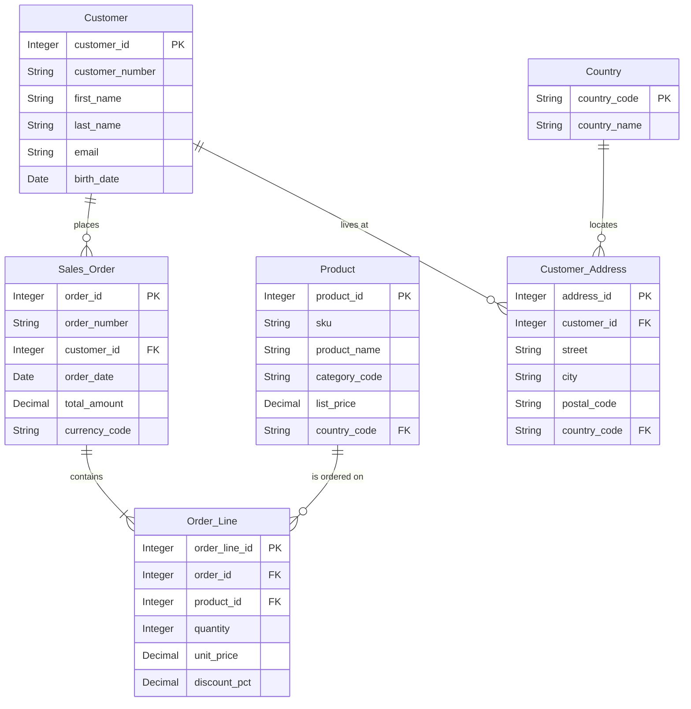

# Retail Co – stage 1 documentation

## Contents

- [Introduction](#introduction)
- [Conventions and notation](#conventions-and-notation)
- [Model overview](#model-overview)
- [Model readiness](#model-readiness)
- [Diagrams](#diagrams)
- [Data dictionary](#data-dictionary)
- [Source-to-target mapping](#source-to-target-mapping)
- [Requirements and coverage](#requirements-and-coverage)
- [Traceability](#traceability)
- [Data quality rules](#data-quality-rules)
- [Source tables](#source-tables)
- [Classification register](#classification-register)
- [Changes since …](#changes-since-)

## Introduction

Scope of this stage: …

Assumptions: …

Open points: …

## Conventions and notation

### Relationship notation

|  | Meaning |
| --- | --- |
| `\|\|` | Exactly one |
| `\|o` | Zero or one |
| `}\|` | One or more |
| `}o` | Zero or more |

### Mapping statuses

|  | Status | Meaning |
| --- | --- | --- |
|  | Draft | Proposed; not reviewed yet. |
|  | In review | Waiting for approval. |
|  | Approved | Agreed; counts towards requirement coverage. |

### Marks in diagrams and tables

| Mark | Meaning |
| --- | --- |
| PK | Primary key |
| FK | Foreign key |
| BK | Business key in the source |
| PII | Personal data |
| = | Calculated from other attributes of the same entity |
|  | Transformation rule on the mapping |
|  | The source type does not fit the attribute |
|  | Row fed (filled) or not yet (ring) |

### Entity stereotypes

| Stereotype | Used |
| --- | --- |
| Object | 4 |
| A business thing with its own identity and life cycle: customer, product, order. |  |
| Link | 1 |
| Connects objects and takes its identity from them, e.g. an order line. |  |
| Dictionary | 1 |
| A list of codes and their meanings (reference data). |  |

### Classifications used

| Classifications | Code | Applies to | Used |
| --- | --- | --- | --- |
| Business key | BK | Column | 4 |
| The column identifies the business object in the source; it survives system changes. |  |  |  |
| Personal data | PII | Column | 6 |
| The column holds personal data in the sense of the GDPR. |  |  |  |

### Physical types in the sources and their logical types

| Physical type | Logical type |
| --- | --- |
| bigint | Integer |
| char(2), char(3) | String |
| date | Date |
| datetime2 | Date |
| decimal(10,2), decimal(12,2), decimal(5,2) | Decimal |
| int | Integer |
| nvarchar(100), nvarchar(200), nvarchar(50), nvarchar(60) | String |
| timestamp | Date |
| tinyint | Integer |
| uuid | String |
| varchar(10), varchar(120), varchar(20), varchar(255), varchar(30) | String |

## Model overview

Enterprise data warehouse for Retail Co: customers, orders and products from CRM, web shop and ERP.

| Model contents | Count |
| --- | --- |
| Entities | 6 |
| Source tables | 6 |
| Mappings | 14 (8 approved) |
| Requirements | 4 |

**Customer**Customer, Customer Address**Sales**Sales Order, Order Line**Product**Product**Reference data**Country

*Figure 1. Logical data model*

## Model readiness

Checks of the model state this document describes. The items listed were open when it was generated.

| Check | Result |
| --- | --- |
| Entities without a definition | 3 |
| Attributes without a definition | 33 |
| Definitions that repeat the name or have fewer than four words | ✓ |
| Attributes with no mapping or feed | 20 |
| Mappings with a type problem | 2 |
| Mappings not approved yet | 6 |
| Requirements not fully covered | 2 |
| Relationships without a copied key | 5 |

Model checks: InfoMapper's validator (D-75), as the project home shows it.

### Entities without a definition (3)

- Customer Address
- Product
- Country

### Attributes without a definition (33)

- Customer.customer_id
- Customer.customer_number
- Customer.first_name
- Customer.last_name
- Customer.email
- Customer.birth_date
- Customer.created_at
- Customer Address.address_id
- Customer Address.customer_id
- Customer Address.street
- … and 23 more

### Attributes with no mapping or feed (20)

- Customer Address.address_id
- Customer Address.customer_id
- Customer Address.street
- Customer Address.city
- Customer Address.postal_code
- Customer Address.country_code
- Sales Order.customer_id
- Sales Order.currency_code
- Order Line.order_line_id
- Order Line.order_id
- … and 10 more

### Mappings with a type problem (2)

- web_users.email → Customer.email
- order_line.item_code → Order Line.product_id

### Mappings not approved yet (6)

- customers.cust_id → Customer.customer_id (Draft)
- customers.dob → Customer.birth_date (In review)
- customers.created_ts → Customer.created_at (In review)
- web_users.email → Customer.email (Draft)
- order_header.ord_status → Sales Order.status_code (Draft)
- order_line.item_code → Order Line.product_id (Draft)

### Requirements not fully covered (2)

- REQ-101 Single view of the customer (4/7)
- REQ-104 Order total equals the sum of its lines (1/4)

### Relationships without a copied key (5)

- Customer – Sales Order (places) · Sales Order has no copy of customer_id
- Sales Order – Order Line (contains) · Order Line has no copy of order_id
- Product – Order Line (is ordered on) · Order Line has no copy of product_id
- Customer – Customer Address (lives at) · Customer Address has no copy of customer_id
- Country – Customer Address (locates) · Customer Address has no copy of country_code

## Diagrams

### Customer & orders

*Figure 2. Customer & orders*

### Order lines & products

*Figure 3. Order lines & products*

### Sales star

*Figure 4. Sales star*

**Legend**Relationship (crow's foot: many; bar: one; circle: optional)Mapping, approvedMapping, in reviewMapping, draftMapping with a type problemƒ transformation ruleDimensional mapping (logical → fact or dimension)Foreign key between source tablesRow fed (filled) or not (ring)

## Data dictionary

### Customer

#### Customer

Object · 6 of 7 attributes mapped

A person or organisation that buys from us.

| Attribute | Type | Keys | Personal data | Mapped from |
| --- | --- | --- | --- | --- |
| customer_id | Integer | PK |  | customers.cust_id Draft |
| customer_number | String |  |  | customers.cust_no |
| first_name | String(50) |  | PII | customers.fname |
| last_name | String(50) |  | PII | customers.lname |
| email | String(120) |  | PII | customers.email_addrweb_users.email Draft |
| birth_date | Date |  | PII | customers.dob In review |
| created_at | Date |  |  | customers.created_ts In review |

##### Relationships

| Related entity | Relationship | Cardinality (this : related) |
| --- | --- | --- |
| Sales Order | places | 1 : 0..* |
| Customer Address | lives at | 1 : 0..* |

#### Customer Address

Object · 0 of 6 attributes mapped

| Attribute | Type | Keys | Personal data | Mapped from |
| --- | --- | --- | --- | --- |
| address_id | Integer | PK |  | Not mapped |
| customer_id | Integer | FK |  | Not mapped |
| street | String |  | PII | Not mapped |
| city | String |  |  | Not mapped |
| postal_code | String |  |  | Not mapped |
| country_code | String | FK |  | Not mapped |

##### Relationships

| Related entity | Relationship | Cardinality (this : related) |
| --- | --- | --- |
| Customer | lives at | 0..* : 1 |
| Country | locates | 0..* : 1 |

### Sales

#### Sales Order

Object · 5 of 7 attributes mapped

A confirmed order placed by a customer.

| Attribute | Type | Keys | Personal data | Mapped from |
| --- | --- | --- | --- | --- |
| order_id | Integer | PK |  | order_header.ord_id |
| order_number | String |  |  | order_header.ord_no |
| customer_id | Integer | FK |  | Not mapped |
| order_date | Date |  |  | order_header.ord_dt |
| total_amount | Decimal |  |  | order_header.ord_total |
| currency_code | String |  |  | Not mapped |
| status_code | String |  |  | order_header.ord_status Draft |

##### Relationships

| Related entity | Relationship | Cardinality (this : related) |
| --- | --- | --- |
| Customer | places | 0..* : 1 |
| Order Line | contains | 1 : 1..* |

#### Order Line

Link · 0 of 6 attributes mapped

One product on one order.

| Attribute | Type | Keys | Personal data | Mapped from |
| --- | --- | --- | --- | --- |
| order_line_id | Integer | PK |  | Not mapped |
| order_id | Integer | FK |  | Not mapped |
| product_id | Integer | FK |  | order_line.item_code Draft |
| quantity | Integer |  |  | Not mapped |
| unit_price | Decimal |  |  | Not mapped |
| discount_pct | Decimal |  |  | Not mapped |

##### Relationships

| Related entity | Relationship | Cardinality (this : related) |
| --- | --- | --- |
| Sales Order | contains | 1..* : 1 |
| Product | is ordered on | 0..* : 1 |

### Product

#### Product

Object · 0 of 5 attributes mapped

| Attribute | Type | Keys | Personal data | Mapped from |
| --- | --- | --- | --- | --- |
| product_id | Integer | PK |  | Not mapped |
| sku | String |  |  | Not mapped |
| product_name | String |  |  | Not mapped |
| category_code | String |  |  | Not mapped |
| list_price | Decimal |  |  | Not mapped |

##### Relationships

| Related entity | Relationship | Cardinality (this : related) |
| --- | --- | --- |
| Order Line | is ordered on | 1 : 0..* |

### Reference data

#### Country

Dictionary · 0 of 2 attributes mapped

| Attribute | Type | Keys | Personal data | Mapped from |
| --- | --- | --- | --- | --- |
| country_code | String | PK |  | Not mapped |
| country_name | String |  |  | Not mapped |

##### Relationships

| Related entity | Relationship | Cardinality (this : related) |
| --- | --- | --- |
| Customer Address | locates | 1 : 0..* |

## Source-to-target mapping

### Customer

| Target | Target type | System | Source column | Source type | Status |
| --- | --- | --- | --- | --- | --- |
| customer_id | Integer | CRM | customers.cust_id | int | Draft |
| Direct copy |  |  |  |  |  |
| customer_number | String | CRM | customers.cust_no | varchar(20) | Approved |
| Direct copy |  |  |  |  |  |
| first_name | String(50) | CRM | customers.fname | nvarchar(50) | Approved |
| Direct copy |  |  |  |  |  |
| last_name | String(50) | CRM | customers.lname | nvarchar(50) | Approved |
| Direct copy |  |  |  |  |  |
| email | String(120) | CRM | customers.email_addr | varchar(120) | Approved |
| Direct copy |  |  |  |  |  |
| email | String(120) | WEB | web_users.email | varchar(255) | Draft |
| Direct copy |  |  |  |  |  |
| birth_date | Date | CRM | customers.dob | date | In review |
| Direct copy |  |  |  |  |  |
| created_at | Date | CRM | customers.created_ts | datetime2 | In review |
| Transformation: CAST(created_ts AS date) |  |  |  |  |  |

### Sales Order

| Target | Target type | System | Source column | Source type | Status |
| --- | --- | --- | --- | --- | --- |
| order_id | Integer | ERP | order_header.ord_id | bigint | Approved |
| Direct copy |  |  |  |  |  |
| order_number | String | ERP | order_header.ord_no | varchar(20) | Approved |
| Direct copy |  |  |  |  |  |
| order_date | Date | ERP | order_header.ord_dt | date | Approved |
| Direct copy |  |  |  |  |  |
| total_amount | Decimal | ERP | order_header.ord_total | decimal(12,2) | Approved |
| Direct copy |  |  |  |  |  |
| status_code | String | ERP | order_header.ord_status | tinyint | Draft |
| Transformation: Decode with the ERP status dictionary (ref.order_status) |  |  |  |  |  |

### Order Line

| Target | Target type | System | Source column | Source type | Status |
| --- | --- | --- | --- | --- | --- |
| product_id | Integer | ERP | order_line.item_code | varchar(30) | Draft |
| Direct copy |  |  |  |  |  |

## Requirements and coverage

#### REQ-101Single view of the customer

Kind: Business needStatus: AgreedPriority: MustCoverage: 4/7

Marketing and service need one trusted customer record across CRM and the web shop.

#### REQ-102Contact data for every active customer

Kind: Data requirementStatus: AgreedPriority: MustCoverage: 3/3

↳ REQ-101 Single view of the customer

First name, last name and e-mail are available for every active customer.

#### REQ-103E-mail is unique per customer

Kind: Data quality ruleStatus: DraftPriority: ShouldCoverage: 1/1

↳ REQ-102 Contact data for every active customer

No two active customers share an e-mail address.

COUNT(DISTINCT customer_id) per lower(email) = 1

#### REQ-104Order total equals the sum of its lines

Kind: Business ruleStatus: DraftPriority: MustCoverage: 1/4

Total amount = sum over lines of quantity × unit price × (1 − discount).

## Traceability

#### REQ-101 Single view of the customer

Business need · 4/7 covered

Marketing and service need one trusted customer record across CRM and the web shop.

| Attribute | Mapped from | Covered |
| --- | --- | --- |
| Customer.customer_id | customers.cust_id Draft | – |
| Customer.customer_number | customers.cust_no | ✓ |
| Customer.first_name | customers.fname | ✓ |
| Customer.last_name | customers.lname | ✓ |
| Customer.email | customers.email_addrweb_users.email Draft | ✓ |
| Customer.birth_date | customers.dob In review | – |
| Customer.created_at | customers.created_ts In review | – |

#### REQ-102 Contact data for every active customer

Data requirement · 3/3 covered

First name, last name and e-mail are available for every active customer.

| Attribute | Mapped from | Covered |
| --- | --- | --- |
| Customer.first_name | customers.fname | ✓ |
| Customer.last_name | customers.lname | ✓ |
| Customer.email | customers.email_addrweb_users.email Draft | ✓ |

#### REQ-103 E-mail is unique per customer

Data quality rule · 1/1 covered

No two active customers share an e-mail address.

| Attribute | Mapped from | Covered |
| --- | --- | --- |
| Customer.email | customers.email_addrweb_users.email Draft | ✓ |

#### REQ-104 Order total equals the sum of its lines

Business rule · 1/4 covered

Total amount = sum over lines of quantity × unit price × (1 − discount).

| Attribute | Mapped from | Covered |
| --- | --- | --- |
| Sales Order.total_amount | order_header.ord_total | ✓ |
| Order Line.quantity | Not mapped | – |
| Order Line.unit_price | Not mapped | – |
| Order Line.discount_pct | Not mapped | – |

## Data quality rules

| Key | Name | On failure | Owner | Applies to |
| --- | --- | --- | --- | --- |
| REQ-103 | E-mail is unique per customer | Warn | Data steward | Customer.email |
| Rule: COUNT(DISTINCT customer_id) per lower(email) = 1 |  |  |  |  |
| Description: No two active customers share an e-mail address. |  |  |  |  |

## Source tables

#### customers

CRM / crmprod.dbo

| Column | Type | Keys | Classifications | Used by |
| --- | --- | --- | --- | --- |
| cust_id | int | PK |  | Customer.customer_id |
| cust_no | varchar(20) |  | Business key BK | Customer.customer_number |
| fname | nvarchar(50) |  | Personal data PII | Customer.first_name |
| lname | nvarchar(50) |  | Personal data PII | Customer.last_name |
| email_addr | varchar(120) |  | Personal data PII | Customer.email |
| dob | date |  | Personal data PII | Customer.birth_date |
| segment | char(3) |  |  |  |
| created_ts | datetime2 |  |  | Customer.created_at |
| updated_ts | datetime2 |  |  |  |

#### customer_addresses

CRM / crmprod.dbo

| Column | Type | Keys | Classifications | Used by |
| --- | --- | --- | --- | --- |
| addr_id | int | PK |  |  |
| cust_id | int | FK |  |  |
| street_line1 | nvarchar(100) |  | Personal data PII |  |
| city | nvarchar(60) |  |  |  |
| zip | varchar(10) |  |  |  |
| country_iso | char(2) |  |  |  |

#### web_users

WEB / shopdb.public

| Column | Type | Keys | Classifications | Used by |
| --- | --- | --- | --- | --- |
| user_id | uuid | PK |  |  |
| email | varchar(255) |  | Personal data PII | Customer.email |
| cust_no | varchar(20) |  | Business key BK |  |
| registered_at | timestamp |  |  |  |

#### order_header

ERP / erpdb.sales

| Column | Type | Keys | Classifications | Used by |
| --- | --- | --- | --- | --- |
| ord_id | bigint | PK |  | Sales Order.order_id |
| ord_no | varchar(20) |  | Business key BK | Sales Order.order_number |
| cust_ref | varchar(20) |  |  |  |
| ord_dt | date |  |  | Sales Order.order_date |
| ord_total | decimal(12,2) |  |  | Sales Order.total_amount |
| curr | char(3) |  |  |  |
| ord_status | tinyint |  |  | Sales Order.status_code |

#### order_line

ERP / erpdb.sales

| Column | Type | Keys | Classifications | Used by |
| --- | --- | --- | --- | --- |
| line_id | bigint | PK |  |  |
| ord_id | bigint | FK |  |  |
| item_code | varchar(30) |  |  | Order Line.product_id |
| qty | int |  |  |  |
| price | decimal(10,2) |  |  |  |
| disc | decimal(5,2) |  |  |  |

#### items

ERP / erpdb.inv

| Column | Type | Keys | Classifications | Used by |
| --- | --- | --- | --- | --- |
| item_code | varchar(30) | PK | Business key BK |  |
| item_desc | nvarchar(200) |  |  |  |
| cat_code | varchar(10) |  |  |  |
| list_prc | decimal(10,2) |  |  |  |

## Classification register

### Personal data

The column holds personal data in the sense of the GDPR.

| Source column | Type | Classifications | Used by |
| --- | --- | --- | --- |
| customers.fname | nvarchar(50) | Personal data PII | Customer.first_name |
| customers.lname | nvarchar(50) | Personal data PII | Customer.last_name |
| customers.email_addr | varchar(120) | Personal data PII | Customer.email |
| customers.dob | date | Personal data PII | Customer.birth_date |
| customer_addresses.street_line1 | nvarchar(100) | Personal data PII |  |
| web_users.email | varchar(255) | Personal data PII | Customer.email |

##### Logical attributes marked personal data

| Attribute | Type | Mapped from |
| --- | --- | --- |
| Customer.first_name | String(50) | customers.fname |
| Customer.last_name | String(50) | customers.lname |
| Customer.email | String(120) | customers.email_addrweb_users.email |
| Customer.birth_date | Date | customers.dob |
| Customer Address.street | String |  |

## Changes since …

Choose the baseline to compare with in the panel on the right.
